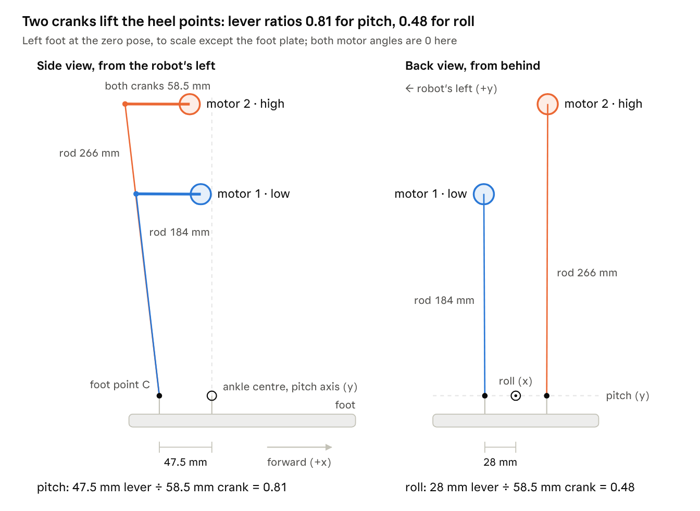

# H2 parallel ankle: mechanism and kinematics

## Summary

Each H2 ankle is a parallel linkage: two motors in the shin drive the foot through two rods, and near the standing pose motor 1 / 2 ≈ 0.81·pitch ± 0.48·roll. ec\_rt's PR mode uses pitch = (m1 + m2) / 2 and roll = (m1 − m2) / 2, which has the right shape but leaves out those two factors: it reads true pitch at 81 % and roll at 48 %.

- **Readings and set-points:** dividing by 2 × 0.8125 and 2 × 0.479 instead of by 2 brings the error from 0.22 rad to 0.005 rad over the walking range.
- **Gains:** a PD gain k on each motor gives the ankle joint 1.32·k on pitch and 0.46·k on roll. No motor gain changes that ratio, so even roll and pitch stiffness needs extra torque from a fast loop.
- **What the runners now do:** AB mode with the exact linkage maths and a 500 Hz feed-forward loop on the robot; an emulation of PR mode in sim, which reproduces the robot's standing ankle torques.

The maths below follows th010's `HumanoidParallelAnkleSolver`, ported to `deploy/h2/h2_ankle.py`.

## The mechanism

The foot hangs on a two-axis joint below the shin, pitch about y and then roll about x, and two motors in the shin move it through crank-and-rod pairs. Coordinates are in the shin frame with the origin at the ankle centre, where the two axes cross: x forward, y to the robot's left, z up, in metres.

Per motor i:

- **Pivot Aᵢ:** fixed on the shin. The motor turns a crank about an axis parallel to y through Aᵢ.
- **Crank end Bᵢ:** 58.5 mm from Aᵢ, behind it (−x) at the zero pose.
- **Rod Bᵢ–Cᵢ:** a link of fixed length with ball joints at both ends.
- **Foot point Cᵢ:** fixed on the foot, 47.5 mm behind the ankle centre and 28 mm to either side. It moves with the foot: Cᵢ(pitch, roll) = R\_y(pitch) R\_x(roll) cᵢ.

Geometry of the left foot (the right foot mirrors it in y, which swaps which motor is high):

| Motor | Pivot A (m) | Crank end B at zero (m) | Foot point c (m) | Crank (mm) | Rod (mm) |
| --- | --- | --- | --- | --- | --- |
| 1 (low, +y side) | (−0.010, 0.0289, 0.1825) | (−0.0685, 0.0289, 0.1828) | (−0.0475, 0.028, 0) | 58.5 | 184 |
| 2 (high, −y side) | (−0.020, −0.0289, 0.264) | (−0.0785, −0.0289, 0.2642) | (−0.0475, −0.028, 0) | 58.5 | 266 |

On both feet the low motor sits on the outer side.

**How the motors share the work:**

- **Pitch:** both motors turn the same way. Both rods lift or lower the back of the foot equally.
- **Roll:** the motors turn opposite ways. One side of the heel goes up and the other down.

The two factors that matter later are lever ratios. Pitching the foot by a small angle moves both C points up or down by 47.5 mm × the angle. A 58.5 mm crank has to turn by 47.5 / 58.5 = 0.81 of that angle. Rolling moves them by ±28 mm × the angle, so 28 / 58.5 = 0.48.

In the back view the cranks point away from the viewer, so only the motors and the nearly vertical rods show. The right foot is the mirror image.

## Inverse kinematics: foot angles to motor angles

The motor angle for a given foot pose has a closed form, because the only constraint is that each rod keeps its length. Work on one motor at a time and drop the index i.

The foot rotates the foot point by T = R\_y(pitch) R\_x(roll):

$$
T = \begin{pmatrix}\cos p & 0 & \sin p\\ 0 & 1 & 0\\ -\sin p & 0 & \cos p\end{pmatrix}\begin{pmatrix}1 & 0 & 0\\ 0 & \cos r & -\sin r\\ 0 & \sin r & \cos r\end{pmatrix},\qquad C = T\,c
$$

The motor turns the crank by θ about y. With u = B₀ − A, the crank at the zero pose, the crank end is:

$$
B(\theta) = A + R_y(\theta)\,u,\qquad R_y(\theta)\,u = \begin{pmatrix}u_x\cos\theta + u_z\sin\theta\\ u_y\\ -u_x\sin\theta + u_z\cos\theta\end{pmatrix}
$$

The rod length l is fixed, and l² = |c − B₀|² at the zero pose. With w = T c − A, the vector from the pivot to the foot point, the constraint is:

$$
\lVert w - R_y(\theta)\,u \rVert^2 = l^2 \;\Longrightarrow\; \lVert u\rVert^2 + \lVert w\rVert^2 - 2\,w\cdot R_y(\theta)\,u = l^2
$$

Expanding the dot product leaves a single equation in θ:

$$
P\cos\theta + Q\sin\theta = K,\qquad P = w_x u_x + w_z u_z,\quad Q = w_x u_z - w_z u_x,\quad K = \tfrac12\left(\lVert u\rVert^2 + \lVert w\rVert^2 - l^2\right) - w_y u_y
$$

Writing the left side as √(P² + Q²) cos(θ − φ) gives the motor angle:

$$
\theta = \mathrm{atan2}(Q, P) + \arccos\frac{K}{\sqrt{P^2 + Q^2}}
$$

Notes on the solution:

- **Branch:** the + root keeps the crank on the side it is built on. It gives θ = 0 at the zero pose for both motors and both feet; the − root is the crank flipped through the rod line.
- **Accuracy:** this is `ankle_ik` in `h2_ankle.py`. It matches th010's C++ solver to 5·10⁻¹⁰ rad over the joint range (pitch −0.96 to 0.38 rad, roll ±0.24 rad).
- **Range:** across that range the motors turn between about −0.74 rad (foot fully down) and 0.42 rad.

## Jacobian and forward kinematics

The Jacobian J = ∂(m1, m2) / ∂(roll, pitch) is close to constant, and its entries are the lever ratios from the mechanism. In the code it is a central difference of the IK. Analytically, it follows from the rod constraint F(θ, x) = |T(x) c − A − R\_y(θ) u|² − l² = 0 by implicit differentiation:

$$
\frac{\partial \theta}{\partial x} = -\frac{\partial F/\partial x}{\partial F/\partial \theta}
$$

At the zero pose the rods are nearly vertical and the cranks nearly horizontal. A crank of radius |u| then has to turn by the vertical travel of its foot point divided by |u|:

$$
J \approx \begin{pmatrix} c_{1y}/|u| & -c_{1x}/|u| \\ c_{2y}/|u| & -c_{2x}/|u| \end{pmatrix} = \begin{pmatrix} 0.028/0.0585 & 0.0475/0.0585 \\ -0.028/0.0585 & 0.0475/0.0585 \end{pmatrix} = \begin{pmatrix} 0.479 & 0.812 \\ -0.479 & 0.812 \end{pmatrix}
$$

The exact IK gives the same values: 0.4789 / 0.8124 and −0.4788 / 0.8123 for the left foot at the zero pose. Over the walking range (roll ±0.1 rad, pitch −0.5 to 0.3 rad) the roll entries stay within 0.454 to 0.480 and the pitch entries within 0.777 to 0.814.

So near standing:

$$
m_1 \approx 0.81\,p + 0.48\,r,\qquad m_2 \approx 0.81\,p - 0.48\,r
$$

**Forward kinematics** (motor angles to foot angles) has no closed form, because the two rod constraints couple pitch and roll. It is solved by Newton's method from the linear guess:

$$
x_0 = \begin{pmatrix} (m_1 - m_2)/(2 \cdot 0.479) \\ (m_1 + m_2)/(2 \cdot 0.8125) \end{pmatrix},\qquad x_{k+1} = x_k - J(x_k)^{-1}\left(\mathrm{IK}(x_k) - m\right)
$$

It converges to 10⁻¹⁰ rad in at most six steps (`ankle_fk`). The linear guess alone is the scaled conversion discussed under ec\_rt's modes below: within 0.005 rad over the walking range and 0.048 rad at the far ends of the joint range.

## Velocities, torques and stiffness

A PD gain on each motor gives the ankle joint 0.46 of it on roll and 1.32 of it on pitch, whatever the gain. Everything here follows from J, with x = (roll, pitch) and m = (m1, m2).

**Velocity and torque.** Speeds map through J. Torques map through its transpose, because the linkage neither stores nor loses power (τ\_mᵀ ṁ = τ\_jᵀ ẋ):

$$
\dot m = J\,\dot x,\qquad \tau_j = J^{\mathsf T}\tau_m,\qquad \tau_m = J^{-\mathsf T}\tau_j
$$

**Motor-level PD.** Each drive runs τ\_m = k (m\* − m) − d ṁ at its own rate. With m\* − m ≈ J (x\* − x), the joint sees:

$$
\tau_j = J^{\mathsf T} k J\,(x^* - x) - J^{\mathsf T} d J\,\dot x,\qquad k\,J^{\mathsf T} J = k\begin{pmatrix} 2 \cdot 0.479^2 & 0 \\ 0 & 2 \cdot 0.812^2 \end{pmatrix} = \begin{pmatrix} 0.459\,k & 0 \\ 0 & 1.320\,k \end{pmatrix}
$$

The off-diagonal terms are 1.6·10⁻⁴ k. Different gains on the two motors do not help: Jᵀ diag(k1, k2) J has diagonal 0.229 (k1 + k2) on roll and 0.660 (k1 + k2) on pitch, so k1 ≠ k2 only adds coupling. Roll is always 0.35 × as stiff as pitch.

**Getting even stiffness.** th010's stack does the whole joint PD itself at 500 Hz and sends motor torques J⁻ᵀ τ\_j. Our AB backend keeps the drive PD (k = 76, d = 1.38: pitch 100 / 1.82, as th010's) and adds only what is missing, as motor feed-forward torque:

$$
K_m = J^{-\mathsf T}\left(\mathrm{diag}(k_r, k_p) - k\,J^{\mathsf T}J\right)J^{-1},\quad D_m = J^{-\mathsf T}\left(\mathrm{diag}(d_r, d_p) - d\,J^{\mathsf T}J\right)J^{-1},\quad \tau_{ff} = K_m\,(m^* - m) - D_m\,\dot m
$$

The gains K\_m and D\_m are refreshed every 20 ms policy tick at the current pose. The 500 Hz loop only needs raw motor angles and speeds, with no forward kinematics. With k\_r = 100 and d\_r = 0.96, drives plus loop give the joint 100.0 / 100.4 stiffness and 0.96 / 1.82 damping on roll / pitch.

## ec\_rt's PR and AB modes

PR mode treats the linkage as if m = p ± r, so every quantity it passes through is off by one of the two lever ratios. ec\_rt reads `ankle_mode` from `~/topstar_h2/ec_rt.conf` once, when it starts.

**PR mode** (`h2_ankle_kinematics.h`). Motor A is the roll slot's, B the pitch slot's, and rd = −1 on the left foot. In th010's motor order the left foot's slot swap and its rd cancel, so both feet work the same way:

$$
p_{PR} = \frac{m_1 + m_2}{2},\quad r_{PR} = \frac{m_1 - m_2}{2};\qquad m_1^* = p_c + r_c,\quad m_2^* = p_c - r_c;\qquad \tau_{p,PR} = \tau_1 + \tau_2,\quad \tau_{r,PR} = \tau_1 - \tau_2
$$

Each motor gets its slot's kp / kd. Against the exact kinematics, near standing:

| Quantity | What PR mode gives | Factor |
| --- | --- | --- |
| Pitch reading | 0.81 × true pitch | 0.81 |
| Roll reading | 0.48 × true roll | 0.48 |
| Pitch set-point | true pitch reached = p\_c / 0.81 | 1.23 |
| Roll set-point | true roll reached = r\_c / 0.48 | 2.09 |
| Pitch torque reading | τ\_p / 0.81 | 1.23 |
| Roll torque reading | τ\_r / 0.48 | 2.09 |
| Stiffness, in PR's own coordinates | 2 kp on both axes | 2 |
| Stiffness, in true joint terms | 1.32 kp pitch, 0.46 kp roll | 1.32 / 0.46 |

The "2 × kp" that `tools/h2_log_actuator_check.py` measured on the robot is the stiffness in PR's own coordinates. The policy, trained on true joint angles, gets the last row.

**How far each conversion is from the exact FK** (both feet, full joint range: pitch −0.96 to 0.38 rad, roll ±0.24 rad):

| Conversion | Max roll error (rad) | Max pitch error (rad) |
| --- | --- | --- |
| PR as it is: (m1 ± m2) / 2 | 0.146 | 0.219 |
| Scaled: divide by 2 × 0.479 and 2 × 0.8125 | 0.044 | 0.048 |
| Scaled, walking range only (roll ±0.1, pitch −0.5 to 0.3) | 0.004 | 0.005 |

Scaling would fix readings and set-points but not the stiffness ratio.

**AB mode.** The ankle slots carry the raw motor angles, commands and gains: left m1 / m2 = slots 4 / 5, right m1 / m2 = slots 11 / 10. The runner does the exact FK and IK and any joint-space control itself, as th010's stack does.

## What the runners do

All H2 runners now pick the ankle handling with `--ankle-mode`, and the sim can emulate PR mode on the real linkage. The code is in `deploy/h2/h2_ankle.py`.

| Mode | Robot (`--backend shm`) | Sim (`--backend sim`) |
| --- | --- | --- |
| `pr` | Unchanged: ec\_rt's PR conversion; the bundle's ankle gains as commanded | `PRAnkleSim`: readings, set-point clamp and per-motor gains as ec\_rt does them, applied through the exact linkage |
| `ab` | `AnkleABBackend`: exact FK / IK, drive PD for pitch plus the 500 Hz feed-forward loop; training gains (bundle kp × `ankle_pr_factor`) | True joint PD at the training gains, which is what drives plus loop give |
| `auto` | Reads `ec_rt.conf` and refuses to start if it changed after ec\_rt started | Same as `legacy` |
| `legacy` | Not allowed | The old model: the commanded ankle gains × `ankle_pr_factor` on the serial joints |

**Feed-forward loop safety:**

- **Clip:** ±40 Nm per motor (`--ankle-ff-max`).
- **Watchdog:** the loop never updates the RL watchdog timestamp, so a stalled main loop still makes ec\_rt damp. DAMP zeroes the feed-forward torque.
- **Stopping:** on stop the loop is ended and the torque zeroed before DAMP is requested.

**Sim results** (plan walk: stand, forward, back, two turns, two sideways moves; 72.5 s, 3 seeds each, all completed):

| Bundle | Ankle model | Tilt p95 / max (deg) | True roll error p95 (rad) | Standing ankle torque, both feet (Nm) | Robot standing torque (Nm) |
| --- | --- | --- | --- | --- | --- |
| h2\_sit\_hw | legacy = ab | 9.4 / 13.0 | 0.138 | 33 |  |
| h2\_sit\_hw | pr | 10.2 / 14.9 | 0.220 | 47 | about 44 |
| h2\_sit\_hw2 | legacy | 9.8 / 13.4 | 0.094 | 42 |  |
| h2\_sit\_hw2 | ab | 9.8 / 14.0 | 0.094 | 42 |  |
| h2\_sit\_hw2 | pr | 11.1 / 17.2 | 0.177 | 88 | 80–130 |

The PR emulation is the first sim model to reproduce the robot's standing ankle torques. For both bundles it gives the worst tilt and about 1.6–1.9 × the roll error of AB mode.

**Not yet tested:** the feed-forward loop has not run on the robot. Its loop timing there and the 40 Nm clip, which h2\_sit\_hw2's higher roll gain reaches at about 0.3 rad of roll error, still need a gantry run.

